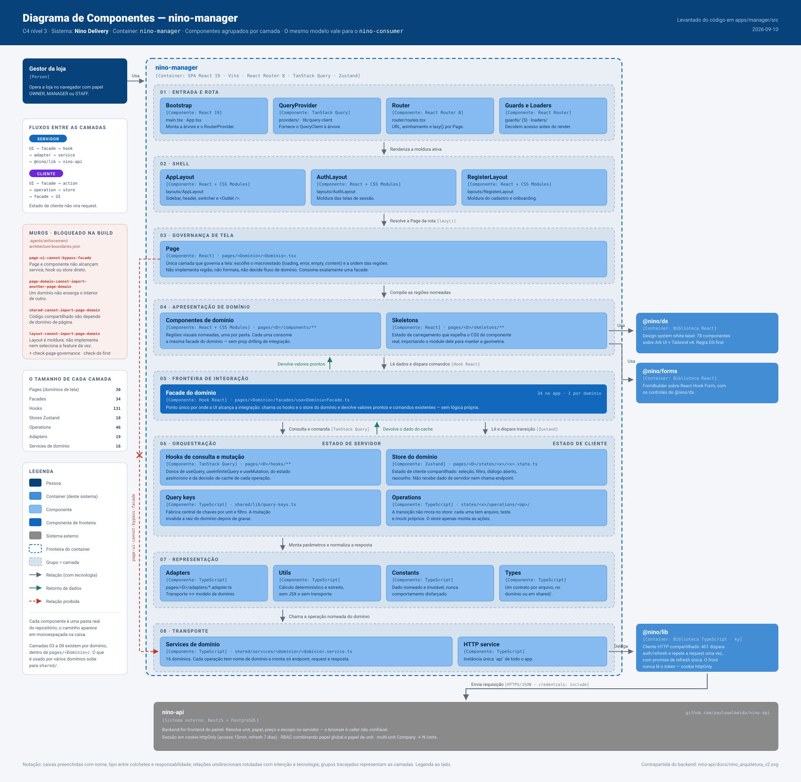

# Nino Delivery — nino-app (manager, consumer, landing, backoffice e courier)

Frontend do **Nino Delivery** — plataforma SaaS White-Label B2B para delivery. O consumidor final nunca vê a marca "Nino": cada loja tem sua própria identidade visual (cor, logo, domínio).

Monorepo Turborepo + npm workspaces: 5 apps, 3 packages compartilhados. Backend: [`nino-api`](https://github.com/paulowalmeida/nino-api) (NestJS + JWT + RBAC).

## Arquitetura

Diagrama de componentes (C4 nível 3) do `nino-manager`, com os componentes agrupados por camada: o caminho que uma intenção da UI percorre até virar request, e os muros que a build bloqueia no caminho. O `nino-consumer` segue o mesmo modelo.



---

## Apps

### `nino-manager` — painel do gestor da loja

**Tem:** app mais maduro do monorepo. 30 domínios de página implementados — auth (`Login`/`Register`/`Welcome`/`ForgotPassword`/`ResetPassword`), seleção de loja, `Overview`, `Orders`/`OrderDetail`/`NewOrder`, catálogo (`Catalog`/`CatalogCategories`/`NewProduct`/`ProductDetail`), `Counter` (PDV), `Kitchen`, `TableTabs`/`TableTabDetail`, `Cash`, `Consumers`/`ConsumerDetail`, `Employees`/`CollaboratorDetail`, `Company`, `Units`/`NewUnit`, `Subscription`, `Settings`, `Reports`, `Profile`. Perfis `OWNER`/`MANAGER`/`STAFF`. SPA Vite + React Router, auth via cookie httpOnly com refresh transparente. Detalhes em [`apps/manager/README.md`](apps/manager/README.md).

**Falta:** itens abertos no roadmap interno do app (switcher de unidade no shell, refinos de M2).

### `nino-consumer` — consumidor final

**Tem:** pedido guest (`POST /orders/guest`, sem conta) e com conta (OAuth → perfil → histórico, fidelidade, endereços e pagamentos salvos). Páginas: `Storefront`, `Checkout`, `OrderTracking`, `Orders`, `SignIn`, `Profile`, `Addresses`, `AccountPayment`, `AccountInvoices`, `AccountChats`. Regras em [`docs/consumer.md`](apps/consumer/docs/consumer.md); direção visual em [`DESIGN.md`](apps/consumer/DESIGN.md).

**Falta:** geolocalização automática de endereço no checkout guest (citada como melhoria futura na própria doc de regras).

### `nino-courier` — entregador

**Falta:** tudo. Só existe o scaffold default do Next.js (`page.tsx`/`layout.tsx`), sem lógica. As regras de negócio já estão escritas em [`docs/courier.md`](apps/courier/docs/courier.md): vínculo N:N com tenants via `CourierTenant`, atribuição de pedido feita pela loja, status de entrega, pagamento negociado fora da plataforma.

### `nino-backoffice` — administração da plataforma Nino

**Falta:** tudo, mesma situação do courier — só scaffold. Regras já documentadas em [`docs/backoffice.md`](apps/backoffice/docs/backoffice.md) (ciclo de vida de subscription, trial, limites de plano, faturamento) e [`docs/profiles.md`](apps/backoffice/docs/profiles.md) (hierarquia `ADMIN`/`SUPPORT`/`MERCHANT`).

### `nino-landing` — site público do lojista

**Entrou depois:** não fazia parte dos 4 apps do plano original. Next.js SSG, consome `@nino/ds`. Setup em [`apps/landing/README.md`](apps/landing/README.md).

---

## Packages

### `@nino/ds` — Design System

**Tem:** 78 componentes sobre Ark UI + Tailwind v4, compartilhado pelos 5 apps. Cor de marca `#FF6B00`. Auditoria de adoção real no manager em [`docs/ds-adocao-gestor.md`](docs/ds-adocao-gestor.md); catálogo completo em [`packages/ds/README.md`](packages/ds/README.md).

**Falta:** componentes pendentes listados no próprio roadmap do DS (`EmptyState` é a lacuna real identificada na auditoria; o resto do backlog é sob demanda, conforme os apps pedirem).

**Entrou depois:** substituiu o `@nino/ui` do plano original, que nunca chegou a existir com esse nome — o escopo final (78 componentes, i18n, máscaras, validadores, Storybook) é bem maior do que os "componentes base" planejados.

### `@nino/forms`

**Entrou depois:** não estava no plano. Integração tipada com React Hook Form sobre o `@nino/ds` — modo schema (formulário linear) e modo composto (layout livre). Detalhes em [`packages/forms/README.md`](packages/forms/README.md).

### `@nino/lib`

**Tem:** `http-client`, `ApiError` e parte dos tipos de domínio, usados por `consumer` e, pontualmente, por `manager`.

**Falta:** geração automática de tipos a partir da API (o Swagger da `nino-api` foi removido, sem substituto ainda). O `manager` já considera os tipos daqui desatualizados e mantém os próprios em `@custom_types` — migração/consolidação pendente.

---

## Stack

| | `manager` / `consumer` | `landing` | `courier` / `backoffice` |
|---|---|---|---|
| Framework | Vite SPA + React 19 | Next.js 16 (SSG) | Next.js 16 (scaffold) |
| Roteamento | React Router 8 (data router) | App Router | App Router |
| Server state | TanStack Query 5 | — | — |
| Client state | Zustand | — | — |
| UI | `@nino/ds` | `@nino/ds` | — |
| Testes | Vitest + Testing Library | — | — |

Comum a todo o monorepo: TypeScript 5.7, ESLint + Prettier, Turborepo v2.

---

## Arquitetura (manager/consumer)

Organização **domain-first** por página, em `src/pages/<domínio>/`. `shared/` só entra para o que é genuinamente cross-domínio.

- **components** — regiões visuais nomeadas da página (header, lista, formulário); consomem a facade, nunca Zustand/Service direto.
- **facades** — fronteira de integração da UI com o domínio; só composição (seleciona/expõe valores e comandos já prontos), sem lógica.
- **hooks** — orquestram `useQuery`/`useMutation`, cache e invalidação do React Query.
- **adapters** — conversão entre o formato de transporte (API) e o modelo de domínio/view.
- **states** — Zustand do domínio (estado client-side compartilhado); operações de transição ficam em `states/<state>/operations/`.
- **skeletons** — loading state que espelha o CSS do componente real que substitui.
- **utils** — cálculo determinístico local ao domínio, sem side effect.

Regras:

- Page governa a tela (macro-estados, composição); não implementa região nem lógica de domínio.
- Domain component consome a facade do domínio; nunca acessa Zustand/Service/React Query direto.
- DS-first: qualquer UI nova investiga o `@nino/ds` antes de implementação local.

Contrato completo em `AGENTS.md` e `.agents/rules/*.md`, auditado por 8 skills e checks mecânicos (`enforce-facades`, `enforce-services`, etc.). **Entrou depois** — não fazia parte do plano original; substituiu a organização Atomic Design antiga (evidência legada em `src/UI`, não destino para código novo).

---

## Variáveis de Ambiente

```env
# apps/manager — .env.local (sem .env.example versionado)
VITE_BASE_URL=http://localhost:3000

# apps/consumer — .env.example
VITE_BASE_URL=http://localhost:3000
VITE_GOOGLE_CLIENT_ID=""   # sem ele, botão "Continuar com Google" some

# apps/landing — .env.example
NEXT_PUBLIC_MANAGER_URL=http://localhost:3002

# apps/courier, apps/backoffice — .env.example
NEXT_PUBLIC_API_URL=http://localhost:3000
```

---

## Desenvolvimento Local

```bash
npm install                # raiz do monorepo
npm run dev                 # todos os apps
npm run dev:manager         # ou dev:consumer, dev:landing
cd apps/courier && npm run dev

npm run type-check
npm run lint
npm run ds:storybook
```

| App | Porta |
|---|---|
| nino-manager | 3001 |
| nino-consumer | 3002 |
| nino-courier | 3003 |
| nino-backoffice | 3004 |
| nino-landing | 3005 |

---

## Commits

Fase atual: desenvolvimento solo, commits diretos em `develop`, sem feature branch nem PR. `main` recebe só releases. Conventional Commits sem prefixo de ticket:

```
feat: implementar fluxo de pedido guest
fix: corrige breadcrumbs que voltavam pra própria tela
refactor: abas da unidade viram destinos soltos
```
